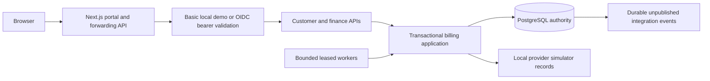

# Architecture and financial policy

The implemented baseline is one Spring Boot process with JDBC transaction boundaries, PostgreSQL financial ownership, and a Next.js portal. There are no independently deployed domain services. Java 21 and Boot 4.1.2 use the modular webmvc/flyway starters and the Boot-managed Jackson 3 stack. An optional Razorpay test-mode Checkout adapter is implemented and disabled by default; test credentials are deployment inputs. See payments/razorpay-sandbox.md for capabilities and webhook verification.

## Calendar and subscription
Original local date/time plus N calendar months defines each boundary. A January 31 anchor produces February 28/29 then March 31. Quarterly uses three months; annual uses twelve. Java resolves DST gaps forward and overlaps to its earlier offset. Zone is fixed at checkout. Trial duration is elapsed UTC days; recurring anchor begins at trial expiry. Price, amount, currency, interval and quantity are snapshotted. Trials are serialized per tenant/customer and any previous subscription denies another trial. Identity fraud prevention is outside this model.

INCOMPLETE awaits verified first payment; ACTIVE is billable, TRIALING converts to INCOMPLETE at its anchor, PAST_DUE access follows the persisted dunning grace policy for previously paid subscribers (initial unpaid subscribers gain no access), PAUSED postpones billing, CANCELLED is terminal. Period-end cancellation is a flag, not a duplicate lifecycle state. Pauses preserve the original calendar; resuming can cause catch-up invoices. This policy requires product review before adoption. Cancellation does not erase receivables or refund cash.

## Concurrency and ownership
Each subscription is the serialization boundary for renewal and lifecycle commands. READ COMMITTED with row locks, advisory trial locks and business uniqueness handles same-key checkout and duplicate jobs. Idempotency rows remain indefinitely and commit with effects. Request payload conflicts return 409. Event creation shares the financial transaction. Each invoice is immediately finalized OPEN: immutable recurring/proration lines are stored; draft editing and tax snapshots are not implemented. Sequence numbers are global to this single legal entity, unique, and may have gaps. Invoice total/currency/number/period are protected against mutation. Journals cannot be updated/deleted.

Atomic SKIP LOCKED claims lease up to sixteen jobs for thirty seconds. Eight claims exhaust automatic handling; exhausted jobs require investigation. A second claimant must still lock the job and subscription; it observes DONE after a successful predecessor commit. Jobs carry an expected cycle index; a duplicate stale job is completed without billing the next period. Invoice identity is (subscription, cycle index) with anchor immutable through supported commands. Financial transaction commits invoice, journal, next job and subscription together.

## Payments, credits and accounting
One logical collection per invoice with independent immutable retry-attempt identities. See dunning.md for bounded retries, verified failure classification, grace and portal recovery. SUCCESS, soft/hard declines, rate limits, authentication/method/mandate failures, ACCEPTED_RESPONSE_LOST and OUTAGE are deterministic simulator cases. UNKNOWN is never charged again. Reconciliation looks up stable provider identity and verifies amount. Capture is represented by verified simulator success; settlement is NOT represented. Automatic collection is enabled by default, using the SUCCESS simulator. Docker Compose disables it (BILLING_AUTO_COLLECT=false) so failure scenarios may be selected manually in the portal. Razorpay network operations run outside SQL transactions, with durable order claims and no automatic repost after uncertainty. Live-mode operations and recurring token charging remain unsupported.

Invoice balance = total - paid - applied credit. Refunds represent returned cash and do not reopen invoice receivables. A credit may only consume outstanding balance before any collection exists. Refund requests lock the captured payment, check remaining refundable amount and allocate once. Simulator refunds are local completed records; no external refund guarantee is claimed.

Each journal stores one equal debit/credit pair and currency, enforcing a balanced two-account posting by construction. Invoice: debit receivable / credit deferred revenue. Capture: debit processor clearing / credit receivable. Credit: debit deferred revenue / credit receivable. Refund: debit refund expense / credit processor clearing. Revenue recognition, tax accounting, settlement fees and jurisdiction-specific refund classification require accounting review.

## Proration
The tested utility calculates remaining whole seconds / original whole seconds, separately rounds old credit and new charge HALF_EVEN to minor units, then takes their difference. The ideal half-period 49900 to 149900 INR minor units yields 50000. Persisted five-minute previews now drive immediate same-interval/currency upgrades and seat increases. Confirmation locks the subscription and checks its revision and outstanding balance, then creates an immutable PRORATION invoice with old-credit and new-charge lines. A zero-net change needs no invoice. Current-period payment is required; any outstanding adjustment blocks a second immediate change. Downgrades and quantity reductions are scheduled for renewal with no immediate credit. Only one scheduled change is allowed; cancellation invalidates it. See plan-changes.md for scope and API contracts.

## Trade-offs
A modular monolith keeps financial commits local and reduces operational cost. Module extraction should wait for independently owned workloads. Microservices would require durable orchestration and explicit compensations. Multi-region writes are unsupported: deploy one authoritative database writer; fencing and restored-worker coordination are required for disaster recovery. Invoice artifacts support S3-compatible or local storage behind private authenticated downloads; financial state remains authoritative in PostgreSQL. Redis and Kafka are not yet integrated. See invoice-documents.md for artifact consistency and recovery. The outbox is durable but has no publisher/inbox, so no delivery claim is made.

## Security
Every API authenticates. Production validates JWTs using Spring resource-server configuration; provide issuer-uri and tenant_id claim. Customer queries constrain both tenant and subject. Finance requires SCOPE_finance (or local ROLE_FINANCE). Demo credentials only work when BILLING_DEMO=true. This is a local HTTP simulator environment; ingress TLS, OAuth login/refresh, audience validation, per-tenant throttling, audit controls and protected storage remain deployment work. No cards, CVV, provider credentials, or tax identifiers are accepted.
