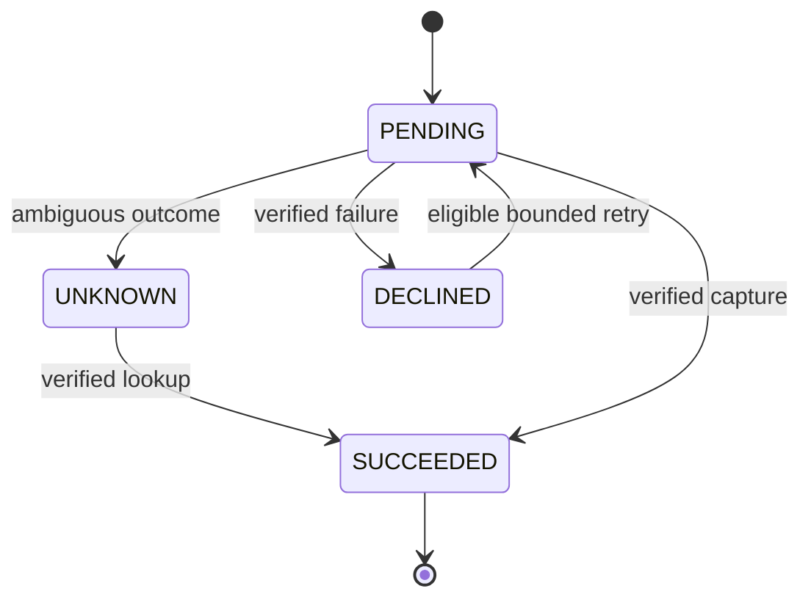
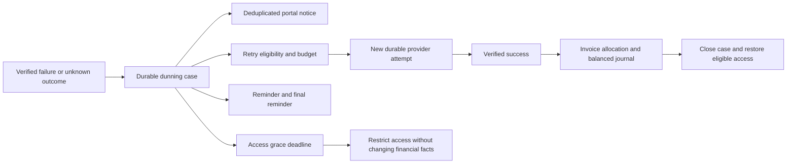

# Bounded collection retries and dunning

Implemented with the local payment simulator. One logical `payments` row belongs to an invoice; each provider operation has a separate `payment_attempts` row and stable UUID. Refundable balance and invoice allocation remain attached to the logical payment. Attempt numbers are unique per payment, and a partial unique index permits at most one pending/unknown attempt. Completed attempts cannot be modified or deleted. Simulator method updates have separate immutable operation records; outbox retention cannot invalidate their idempotency.

## Retry contract

| Verified outcome | Action |
|---|---|
| SOFT_DECLINE, TEMPORARY_FAILURE | Schedule a new attempt after bounded backoff |
| RATE_LIMIT | Honor the simulator's explicit 24-hour Retry-After minimum, including manual recovery with a different method |
| HARD_DECLINE, EXPIRED_METHOD, INVALID_MANDATE, AUTHENTICATION_REQUIRED | No automatic retry; customer action required |
| PENDING or UNKNOWN | No manual or automatic retry or method-recovery shortcut; look up the existing attempt identity |
| SUCCEEDED | Allocate once, post one balanced journal, close dunning and cancel retry scheduling |

`SOFT_DECLINE_THEN_SUCCESS` verifies a failure on the first attempt and a success on the second. `SOFT_DECLINE` and `TEMPORARY_FAILURE` continue failing until their budget is exhausted or a new simulated method is explicitly authorized. `ACCEPTED_RESPONSE_LOST` creates provider evidence but leaves the local payment UNKNOWN; finance reconciliation verifies it. `OUTAGE` has no provider evidence and stays UNKNOWN. Simulator status absence is never interpreted as failure.

Each retry requires a verified failed outcome, an open invoice, an eligible noncancelled/nonpaused subscription, remaining attempt count and time budget, and elapsed provider/backoff timing. Hard failures require explicit method recovery for a **manual** retry. A manual retry cannot reset the budget or bypass Retry-After. Updating a method does not initiate collection. Retry request identity is scoped by tenant and logical payment, and same-key replay returns the same attempt even if it has since completed. Concurrent distinct-key requests also serialize on the logical payment; only one can create an in-flight attempt. Finance uses the same eligibility checks and cannot override budgets.

No live provider or hosted card/setup integration is implemented. `POST .../simulator-method` exists only with BILLING_DEMO=true, accepts no card data and records only a synthetic method version. Production must implement an independently verified provider setup/action adapter. The simulator's known no-capture failure states justify new attempts here; these semantics must not be assumed for a live provider.

## Configured policy

| Spring property | Default | Meaning |
|---|---:|---|
| billing.retry.max-attempts | 4 | Includes the initial attempt; validated range 1..8 |
| billing.retry.base-seconds | 21600 | Six-hour initial delay; subsequent delays double, capped at two days before jitter |
| billing.retry.window-seconds | 604800 | Seven-day retry window starting at first observed failure |
| billing.retry.grace-seconds | 864000 | Ten-day grace deadline starting at first observed failure |

Delay adds deterministic per-payment/attempt jitter from zero to just under 20% of the capped delay. Provider Retry-After is then a minimum. Max attempts, base delay and deadline are persisted at first failure; reminder and grace timestamps are persisted in the case. Deployment policy changes do not silently extend existing budgets. Time window must be at least the base delay, grace at least the time window; window is capped at 30 days and grace at 90 days. Use environment names such as BILLING_RETRY_BASE_SECONDS for local configuration. Policy administration per tenant and operator overrides remain future work.

Maximum amplification is four total attempts per invoice by default, not four retries plus the original. Exhausted budgets require a separate audited financial resolution, which is not implemented as a bypass button.

## Dunning and entitlement policy

First failure creates one durable case and one INITIAL notice. A reminder is due halfway through the grace interval, the final reminder at three quarters, and restriction at the grace deadline. Unique `(payment, kind)` records deduplicate reminders. Notifications are immutable **portal notices**, not emails/SMS; external sending and delivery acknowledgement are not implemented. Overdue stale reminders are skipped when grace has already expired. Recovery records one RECOVERED notice, clears retry scheduling, and prevents further reminder processing.

PAST_DUE subscribers with previous paid-invoice evidence retain access only while their unresolved dunning cases are inside grace. Initial unpaid subscribers do not gain access through dunning. Any expired unresolved case denies access even if the worker is delayed: the entitlement API evaluates database time directly. Paying one invoice does not restore ACTIVE while another payment is failed, pending or unknown. PAUSED and CANCELLED are never reactivated by collection. Resume reevaluates declined/unknown payments and returns to PAST_DUE when necessary; it cannot bypass dunning. Immediate cancellation stops subsequent dunning work and retries; an already-authorized in-flight collection may still finish for the outstanding invoice. Historical receivables remain payable.

Cases use OPEN, ACTION_REQUIRED, UNKNOWN, EXHAUSTED, RESTRICTED, RECOVERED and STOPPED. Attempt-count exhaustion stops charging while grace can continue. UNKNOWN and ACTION_REQUIRED do not become retryable through reminder processing. Normal retry-window expiry produces EXHAUSTED; grace expiry produces RESTRICTED. Cancellation produces STOPPED. Uncertain payment status remains explicitly UNKNOWN even after access restriction.

## Concurrency and crash recovery

Retry/worker execution locks the logical payment before invoice/subscription changes. Attempt insertion, aggregate update, outbox, invoice allocation and ledger posting share the PostgreSQL transaction. A crash before commit rolls back the attempt stage; the due record remains eligible. A crash after commit leaves PENDING work discoverable. Two workers may read the same due candidate; row locks, the stable scheduled operation key and attempt constraints prevent duplicate effects. Workers select at most sixteen candidates per stage. Cancelled/paused subscriptions are excluded from retry candidate scans, and eligibility is rechecked under locks. Reminder and payment completion also serialize on the same payment; payment-first processing emits no further reminders, and reminder-first processing can emit at most one notice of each kind before verified recovery.

These transactions cover a deterministic database-backed simulator only. A real network adapter must persist/claim the attempt, release database locks, call with bounded timeouts and declared provider guarantees, then commit verified results. Never put live network I/O inside these SQL transactions or automatically convert a timeout into a failed attempt.

## APIs and portal

All API responses use 200 for successful commands/reads; conflicts return RFC 9457 Problem Details with 409, unauthorized ownership returns 404, missing credentials 401 and missing finance role/scope 403. Read lists are bounded to 100 records; cursor pagination is outstanding. Mutations require Idempotency-Key. Retry accepts no override amount, timing, outcome or attempt limit.

| Endpoint | Authorization and effect |
|---|---|
| GET /api/v1/customers/me/dunning | Tenant + subject; failure state, budget, retry/grace dates and required action |
| GET /api/v1/customers/me/notifications | Tenant + subject; durable portal notices |
| GET /api/v1/payments/{id}/attempts | Payment ownership; ordered immutable attempt history |
| POST /api/v1/payments/{id}/retry | Payment ownership; one eligible bounded retry |
| POST /api/v1/payments/{id}/simulator-method | Payment ownership + demo mode; explicit method recovery without a charge |
| GET /api/v1/admin/dunning | Finance role/scope + tenant; queue with retry timing and failure classes |
| GET /api/v1/admin/payment-attempts | Finance role/scope + tenant; recent attempt inspection |
| POST /api/v1/admin/payments/{id}/retry | Finance role/scope + tenant; same bounded retry controls |
| POST /api/v1/admin/reconciliation/run | Existing finance endpoint; verifies unknown provider outcomes |

Customer **Recovery** shows financial amount, attempt count, next scheduled retry, provider minimum, grace deadline, current access, notices, method recovery and request-identity-backed retry confirmation. **Finance** exposes the dunning queue and the same safe retry action. Use Refresh to update asynchronous statuses; there is no misleading immediate payment-success message. Local nonfinance account `customer / local-only` exercises RBAC; its records are a separate tenant from `demo`.

## Operations and remaining risks

Inspect UNKNOWN via reconciliation; never create a second payment to bypass uncertainty. Inspect EXHAUSTED without resetting counters or deleting attempt history. Investigate RESTRICTED cases and outstanding invoices before restoring access. Never log request bodies or provider credentials. Existing source outbox records remain unpublished; this phase does not add Kafka or email delivery. Customer-notice delivery receipts, provider authentication callbacks, actual mandate replacement, configurable per-tenant policies, financial approval workflows and production SLO/load tests remain outstanding. No new benchmark or production-readiness claim is made.
